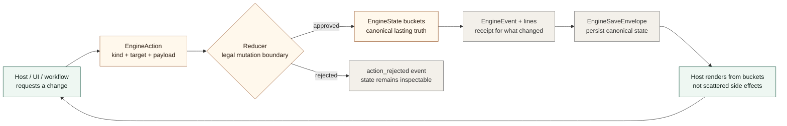

# RD Engine


`RD Engine` is a tiny reducer-governed deterministic state core.

It is meant to be easy to pick up, drop into a project, and rename to fit your domain.

Terminology boundary: in this repository, `truth` means the canonical saved state
the host agrees to treat as authoritative for a workflow. It is not a claim of
factual certainty, model knowledge, consciousness, or mind-like cognition.

Core idea:

- keep lasting truth in buckets
- mutate buckets only through reducers
- emit events that explain the mutation
- save canonical state directly

That is the whole mechanism.

## Reducer Loop



## What You Can Copy

The crate gives you a very small surface:

- `EngineState`
- `EngineAction`
- `EngineEvent`
- `EngineOutcome`
- `Reducer`
- `apply_action(...)`
- `EngineSaveEnvelope`

If you only want those files and want to rename everything else, that is a valid use of this repo.

If you want the shortest possible path, copy:

- [engine.rs](src/engine.rs)
- [save.rs](src/save.rs)

and start renaming from there.

## Copy Into Your Repo

If you want to lift this straight into another project:

1. Copy [engine.rs](src/engine.rs) into your project.
2. Copy [save.rs](src/save.rs) if you want save/load.
3. Keep these concepts:
   `templates`, `buckets`, `actions`, `reducers`, `events`.
4. Rename only the domain nouns inside your reducer and bucket keys.
5. Start with one tiny reducer for one real problem in your project.

Good first bucket names:

- `active_projects`
- `memory_cards`
- `workflow_stages`
- `repo_blockers`
- `scene_state`

Good first action names:

- `remember`
- `set_stage`
- `add_blocker`
- `claim`
- `resolve`

Good first rule:

- if it changes lasting truth, make it go through a reducer

## What This Repo Is Not

This repo is not trying to make you adopt:

- one bucket vocabulary
- one file format
- one game schema
- one memory schema
- one UI model

## Minimal Example

```rust
use rd_engine::{EngineAction, EngineEvent, EngineOutcome, EngineState, Reducer, apply_action};
use serde_json::{Value, json};

struct TodoReducer;

impl Reducer for TodoReducer {
    fn apply(&self, state: &mut EngineState, action: &EngineAction) -> Result<EngineOutcome, String> {
        match action.kind.as_str() {
            "add_task" => {
                let title = action.payload.get("title").and_then(Value::as_str)
                    .ok_or("missing payload.title")?;
                state.ensure_array_bucket("tasks").push(json!({
                    "title": title,
                    "done": false
                }));
                Ok(EngineOutcome {
                    events: vec![EngineEvent::new("task_added").with_bucket("tasks")],
                    lines: vec![format!("Added task '{}'.", title)],
                })
            }
            _ => Err(format!("Unknown action '{}'.", action.kind)),
        }
    }
}

let reducer = TodoReducer;
let mut state = EngineState::new();
let action = EngineAction::new("add_task").carrying(json!({
    "title": "Adapt this engine to my own project"
}));
let outcome = apply_action(&reducer, &mut state, action);
# let _ = outcome;
```

The bucket could just as easily be called:

- `memory_cards`
- `active_projects`
- `workflow_stages`
- `repo_blockers`
- `scene_entities`

## Good Uses

- project memory
- workflow tools
- repo orchestration
- scenario runtimes
- routing systems
- local-first assistant state

Examples of adjacent work where the same idea matters:

- [semantic-signal-alphabet](https://github.com/instance001/semantic-signal-alphabet)
- [llm-defined-persistent-memory](https://github.com/instance001/llm-defined-persistent-memory)
- [chatty-quest](https://github.com/instance001/chatty-quest)

## Quick Start

1. Define the buckets you want to persist.
2. Write a reducer that owns the legal mutations.
3. Call `apply_action(...)` instead of mutating state from the UI.
4. Save `EngineState` when continuity matters.

## Naming Advice

If `buckets` is not the right word in your project, rename it immediately.

Common replacements:

- `memory`
- `store`
- `state`
- `records`
- `lanes`
- `stages`
- `registry`

## Where To Read Next

- [docs/00_core_idea.md](docs/00_core_idea.md)
- [docs/01_drop_in_guide.md](docs/01_drop_in_guide.md)
- [docs/02_use_cases.md](docs/02_use_cases.md)
- [GLOSSARY.md](GLOSSARY.md)
- [examples/minimal_host.rs](examples/minimal_host.rs)
- [examples/project_memory_host.rs](examples/project_memory_host.rs)
- [examples/memory_state.json](examples/memory_state.json)
- [examples/workflow_state.json](examples/workflow_state.json)

## Repo Layout

```text
rd-engine/
  assets/
    branding/
  docs/
  examples/
  src/
  Cargo.toml
  CHANGELOG.md
  README.md
```

## License

This repo is distributed under the `GNU Affero General Public License v3.0 or later` (`AGPL-3.0-or-later`), consistent with `Cargo.toml`.

See [LICENSE](LICENSE).

## Provenance, attribution, and citation

- [Project provenance and attribution guidance](PROVENANCE.md)
- [Citation metadata](CITATION.cff)
- [Copy notices and voluntary logo/acknowledgement guidance](NOTICE.md)

Copying code carries the applicable software-licence obligations. Crediting the documented architecture when it genuinely informed independent work is encouraged as voluntary scholarly/professional practice; it is not a licence condition for independently created methods.
